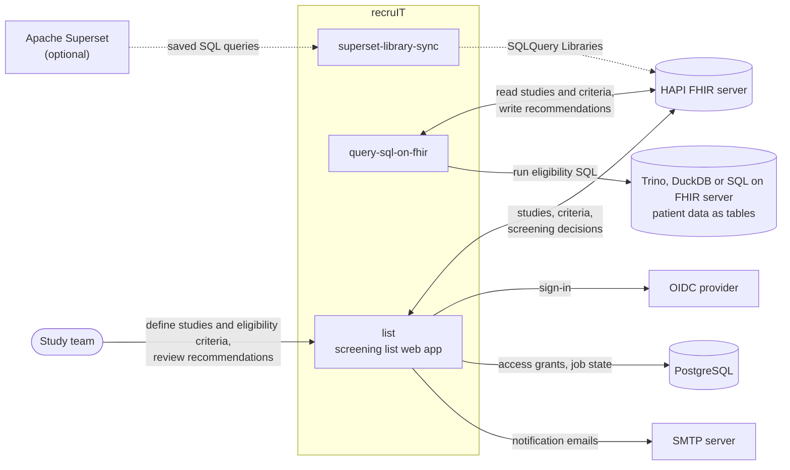

<!-- The hero at the top of this page is defined in overrides/home.html. -->

## Features

<!-- the first card spans the full row and the six cards below it fill whole rows; the layout is in _css/extra.css -->
<div class="grid cards rc-features" markdown>

- :lucide-scan-search:{ .lg } **Eligibility criteria as SQL**

    Write each inclusion and exclusion criterion as a SQL query against your clinical data, run on
    Trino, DuckDB or a SQL on FHIR server. Criteria are stored as standard SQL on FHIR `Library`
    resources, so they can be shared between studies and hold the same query in several SQL dialects.
    Each query decides, per patient, whether the criterion is met. Patients whose data is missing
    stay on the list for the study team to review instead of being silently dropped:

    ```sql
    SELECT p.id AS patient_id,
           CASE WHEN p.birth_date IS NULL THEN NULL
                ELSE date_diff('year', date(p.birth_date), current_date) >= 18
           END AS is_met,
           CAST(NULL AS BOOLEAN) AS is_indeterminate,
           CAST(NULL AS VARCHAR) AS result_note
    FROM fhir.default.patient p
    ```

    [:octicons-arrow-right-24: Learn about the query module](trino/index.md)

- :lucide-square-pen:{ .lg } **Trial editor**

    Create a study and put together its eligibility criteria in the browser: write new criteria or
    reuse existing ones from the library catalog, then publish them to the FHIR server.

    [:octicons-arrow-right-24: Create your first study](getting-started/creating-your-first-study.md)

- :lucide-list-checks:{ .lg } **Screening lists**

    Review each candidate's clinical summary and which criteria they meet, move them from candidate
    through screening to on-study, and keep notes and a full change history.

- :lucide-filter:{ .lg } **Recruitment funnel**

    See how many patients remain after each eligibility criterion, to spot the criteria that
    narrow down a trial's candidate pool the most.

- :lucide-mail:{ .lg } **Notifications**

    Find new candidates for your trials in the app's notification list, and get an email as soon
    as they turn up, or a daily, weekly or monthly digest instead.

    [:octicons-arrow-right-24: Notifications](configuration/notifications.md)

- :lucide-shield-check:{ .lg } **Secure**

    OIDC-based sign-in with access to each screening list granted per user. Minimal, non-root
    container images and a Helm chart hardened following the NSA/CISA Kubernetes Hardening
    Guidance, with signed SLSA build provenance for every release.

    [:octicons-arrow-right-24: Authentication](configuration/options.md#authentication)

- :lucide-cloud:{ .lg } **Cloud-native**

    Deploy with Docker Compose or the Helm chart, with Prometheus metrics and OpenTelemetry tracing.
    Setups for high availability, service meshes and network policies are documented.

    [:octicons-arrow-right-24: Deploy on Kubernetes](deployment/kubernetes.md)

</div>

## How it works



recruIT is made up of modules that talk to each other via HL7 FHIR® through a central FHIR server:

1. In the **list** module, the study team defines each study and its eligibility criteria, stored on the
   FHIR server as `ResearchStudy`, `Group` and SQL-based `Library` resources.
2. The **query-sql-on-fhir** module runs each study's eligibility SQL against Trino, DuckDB or a SQL on FHIR server
   and stores the matching patients on the FHIR server as screening recommendations.
3. The **list** module shows these recommendations to the study team, who record their screening decisions,
   and emails the team whenever new recommendations arrive.
4. Optionally, the **superset-library-sync** module turns saved SQL queries from Apache Superset into
   eligibility criteria the other modules can use.

All FHIR resources recruIT uses are described in its [FHIR Implementation Guide](https://openrecruit.dev/fhir/).

[:octicons-arrow-right-24: Read the architecture overview](getting-started/introduction.md)

## Published research

recruIT was initially developed within [MIRACUM](https://www.miracum.org/), a consortium of German university hospitals.
Its design and implementation are described in:

!!! quote ""

    Gulden C, Macho P, Reinecke I, Strantz C, Prokosch HU, Blasini R.
    **recruIT: A cloud-native clinical trial recruitment support system based on Health Level 7 Fast Healthcare
    Interoperability Resources (HL7 FHIR) and the Observational Medical Outcomes Partnership Common Data Model (OMOP CDM).**
    _Computers in Biology and Medicine_. 2024;174:108411.
    [doi:10.1016/j.compbiomed.2024.108411](https://doi.org/10.1016/j.compbiomed.2024.108411)

<div class="rc-cta" markdown>

## Try it out

Run recruIT with sample data and a sample study on your own machine in a few minutes.

[Get started](getting-started/installation.md){ .md-button .md-button--primary }
[View on GitHub](https://github.com/open-recruit/recruit){ .md-button }

</div>
