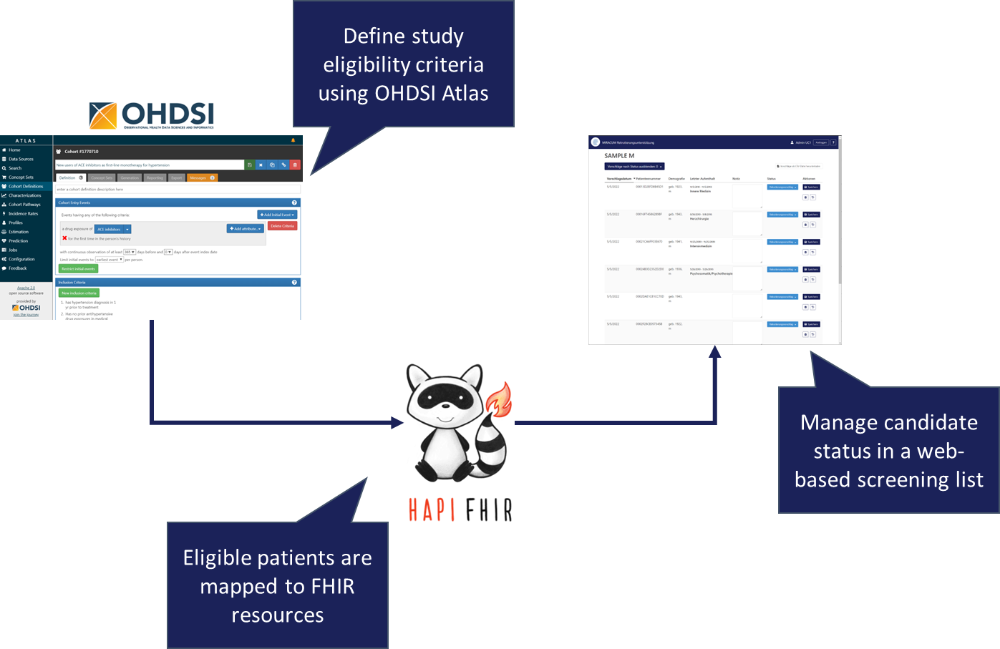

<!-- The hero at the top of this page is defined in overrides/home.html. -->

## Features

- :lucide-scan-search:{ .lg } **Eligibility criteria as SQL**

    ---

    Define a trial's inclusion and exclusion criteria as a cohort using Trino-SQL against
    FHIR ressources encoded as Delta Lake tables.

    [:octicons-arrow-right-24: Create your first study](getting-started/creating-your-first-study.md)

- :lucide-list-checks:{ .lg } **Screening lists**

    ---

    Study teams can review candidates in a web-based screening list: track each one's recruitment
    status, add notes, and view the change history.

    [:octicons-arrow-right-24: Customize the user interface](configuration/ui-configuration.md)

- :lucide-mail:{ .lg } **Email notifications**

    ---

    Subscribe to email notifications as soon as new candidates are added to one of
    the screening lists, or get updated about new candidates on a regular schedule.

    [:octicons-arrow-right-24: Configuration options](configuration/options.md)

- :lucide-shield-check:{ .lg } **Secure**

    ---

    OIDC-based sign-in with the access to screening lists configurable per-user.

    [:octicons-arrow-right-24: Security](configuration/security.md)

- :lucide-cloud:{ .lg } **Cloud-native**

    ---

    Deploy with Docker Compose or the Helm chart: high availability, service meshes, network
    policies, Prometheus metrics and OpenTelemetry tracing included.

    [:octicons-arrow-right-24: Deploy on Kubernetes](deployment/kubernetes.md)

## How it works

{ .rc-diagram }

recruIT is made up of three modules that talk to each other via HL7 FHIR® through a central FHIR server:

1. The **query** module turns each study's eligibility criteria into a list of matching patients and stores
   them on the FHIR server as screening recommendations.
2. The **list** module shows these recommendations to the study team, who record their screening decisions.
3. The **notify** module tells the team by email whenever new recommendations arrive.

All FHIR resources recruIT uses are described in its [FHIR Implementation Guide](https://open-recruit.github.io/recruit/fhir/).

[:octicons-arrow-right-24: Read the architecture overview](getting-started/introduction.md)

## Published research

recruIT is developed within [MIRACUM](https://www.miracum.org/), a consortium of German university hospitals.
Its design and implementation are described in:

!!! quote ""

    Gulden C, Macho P, Reinecke I, Strantz C, Prokosch HU, Blasini R.
    **recruIT: A cloud-native clinical trial recruitment support system based on Health Level 7 Fast Healthcare
    Interoperability Resources (HL7 FHIR) and the Observational Medical Outcomes Partnership Common Data Model (OMOP CDM).**
    _Computers in Biology and Medicine_. 2024;174:108411.
    [doi:10.1016/j.compbiomed.2024.108411](https://doi.org/10.1016/j.compbiomed.2024.108411)

## Try it out

Run recruIT with sample data and a sample study on your own machine in a few minutes.

[Get started](getting-started/installation.md){ .md-button .md-button--primary }
[View on GitHub](https://github.com/miracum/recruit){ .md-button }

