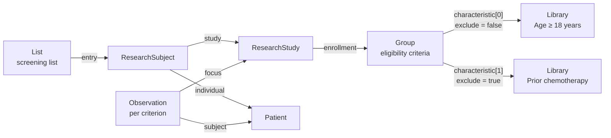

# Query module

The query module (`query-sql-on-fhir`) finds the candidates for each study. On a schedule, it runs every study's
eligibility criteria as SQL against your clinical data, and writes the patients who may be eligible to the FHIR server
as the study's screening list.

The SQL can run on:

- [Trino](https://trino.io/), querying FHIR resources stored as Delta Lake tables, e.g. created by
  [Pathling](https://pathling.csiro.au/). This is the setup for production-sized data, see
  [Docker Compose](../deployment/compose.md) for how to set up the tables.
- An embedded [DuckDB](https://duckdb.org/) reading FHIR resources straight from NDJSON files. It needs no
  lakehouse, which makes it a good fit for demos and small data sets, see
  [Querying FHIR resources with DuckDB](#querying-fhir-resources-with-duckdb).
- A SQL on FHIR server such as Pathling, via its
  [`$sqlquery-run`](https://build.fhir.org/ig/FHIR/sql-on-fhir-v2/OperationDefinition-SQLQueryRun.html) operation,
  see [How a criterion is run](#how-a-criterion-is-run).

Whichever you use, its data must come from the same FHIR server recruIT is connected to: the query module refers to each
candidate as `Patient/<id>`, so the patient ids must match. See [Configuration options](../configuration/options.md)
for all of the module's settings.

## How studies and criteria are stored

A study's criteria are plain FHIR resources, which you can create in the list module's Trial Editor (see
[Creating your first study](../getting-started/creating-your-first-study.md)) or directly on the FHIR server:



- The `ResearchStudy` references a `Group` whose `characteristic`s are the study's criteria, in order. Each one has a
  human-readable `code.text`, references the `Library` holding the criterion's SQL, and has `exclude` set to `true`
  for exclusion criteria.
- Each `Library` uses the [SQLQuery](https://build.fhir.org/ig/FHIR/sql-on-fhir-v2/StructureDefinition-SQLQuery.html)
  profile from [SQL on FHIR v2](https://build.fhir.org/ig/FHIR/sql-on-fhir-v2/index.html). The same `Library` can be
  referenced by several studies, so common criteria only need to be written once.
- The query module writes the results: a `ResearchSubject` and `List` entry per candidate, and an `Observation` per
  candidate and criterion recording whether it is met. The screening list shows these for each candidate.

All of these resources are described in the [FHIR Implementation Guide](https://open-recruit.github.io/recruit/fhir/).

## Writing a criterion

A criterion's SQL returns one row per patient with these columns:

| Column             | Type              | Meaning                                                                 |
| ------------------ | ----------------- | ----------------------------------------------------------------------- |
| `patient_id`       | string            | The id of the `Patient` resource.                                       |
| `is_met`           | boolean           | Whether the criterion applies, `NULL` if unknown, e.g. data is missing. |
| `is_indeterminate` | boolean, optional | If `is_met` is `NULL`: `true` if data is inconclusive, not missing.     |
| `result_note`      | string, optional  | A free-text explanation shown on the screening list.                    |

```sql
SELECT p.id AS patient_id,
       CASE WHEN p.birth_date IS NULL THEN NULL
            ELSE date_diff('year', date(p.birth_date), current_date) >= 18
       END AS is_met
FROM fhir.default.patient p
```

Keep these in mind:

- **Write exclusion criteria un-negated.** For "no prior chemotherapy", select whether the patient *had*
  chemotherapy and set `exclude` to `true` on the `Group.characteristic`. The query module negates it.
- **Cover the whole patient population.** Start from the `patient` table and `LEFT JOIN` the data the criterion
  needs, so a patient without matching data gets `NULL` instead of no row at all.
- **Missing data doesn't rule a patient out.** A patient is a candidate unless at least one criterion is definitely
  not met, so patients with unknown criteria are put on the screening list for the study team to review. Set
  `QUERY_SQL_ON_FHIR_REQUIRE_ALL_CRITERIA_MET=true` to only list patients who meet every criterion.
- **Absence of a record isn't proof.** "No chemotherapy procedure found" may only mean that your data doesn't cover
  the patient's full history. Decide per criterion whether that should count as not met or as unknown.

[Design: Per-Criterion Eligibility Status](eligibility-criteria-design.md) explains how criteria are combined and
covers more examples, including indeterminate results.

### Testing criteria

Before running a new study on production data, set `QUERY_SQL_ON_FHIR_DRY_RUN=true`. The query module then runs the
queries and logs how many patients would be listed per study and criterion, without writing anything to the FHIR
server:

```text
Dry run result for study ResearchStudy/trial-042: 847 patients would be submitted
  (312 all criteria met, 535 with at least one unknown criterion)
  Criterion 'Age >= 18 years' (inclusion): 847 met, 0 unknown
  Criterion 'AML (C92.x)' (inclusion): 312 met, 535 unknown
```

A large number of unknowns for a criterion usually means it doesn't cover the whole patient population.
`QUERY_SQL_ON_FHIR_MAX_RESEARCH_SUBJECTS` additionally stops a study from being processed if it would list more
patients than that.

### Recruitment funnel

With `QUERY_SQL_ON_FHIR_FUNNEL_ENABLED=true`, the query module also counts how many patients remain after applying
each criterion in turn, and the screening list shows this as a funnel. Computing it is a more expensive query than the
eligibility query itself, so it's disabled by default.

## How a criterion is run

A `Library` holds the criterion's SQL as `content` with the content type `application/sql;dialect=<dialect>`, and can
hold the same criterion in several dialects side by side. The sample study's Libraries (see
[`sample-study.fsh`](https://github.com/open-recruit/recruit/blob/master/fhir/ig/input/fsh/sample-study.fsh)) carry
each criterion for both Trino and DuckDB.

For each criterion, the query module checks:

1. If the `Library` has no `relatedArtifact` entries and has content in the configured dialect
   (`QUERY_SQL_ON_FHIR_SQL_DIALECT`, `trino` by default), the SQL is run directly against the configured database.
2. Otherwise, i.e. the query depends on SQL on FHIR `ViewDefinition`s referenced via `relatedArtifact`, or isn't
   available in the configured dialect, the whole `Library` is sent to the `$sqlquery-run` operation of the SQL on FHIR
   server configured via `SQL_ON_FHIR_URL`. Without one, studies with such criteria fail to run.

## Querying FHIR resources with DuckDB

Instead of Trino, the query module can run the eligibility criteria against an embedded, in-memory DuckDB that reads
FHIR resources straight from NDJSON files, e.g. a [FHIR bulk export](https://hl7.org/fhir/uv/bulkdata/). This needs no
lakehouse, Hive metastore, or Trino, but since the files are re-read on every run, it doesn't scale to a
production-sized patient population.

The Helm chart's [demo values](../getting-started/installation.md) use it: `syntheticPatients.enabled=true` loads
synthetic patients generated by [Synthea](https://github.com/synthetichealth/synthea) into the FHIR server, and an
init container of the query module's pod generates the exact same patients (same seed, same resource ids) once more
as NDJSON files into `/data/fhir/`. The views over them are created by `querySqlOnFhir.duckdb.initSql`, which is run
on every new connection, since each one is its own, empty in-memory database:

```yaml
querySqlOnFhir:
  sqlDialect: duckdb
  duckdb:
    initSql: |
      ATTACH ':memory:' AS fhir;
      CREATE SCHEMA fhir."default";
      CREATE VIEW fhir."default".patient AS SELECT * FROM read_json('/data/fhir/Patient.ndjson');
      CREATE VIEW fhir."default".condition AS SELECT * FROM read_json('/data/fhir/Condition.ndjson');
      USE fhir."default";
```

To query your own NDJSON files instead, mount them into the pod via `querySqlOnFhir.extraVolumes` and
`querySqlOnFhir.extraVolumeMounts`.

The views are named like the Delta Lake tables queried via Trino (`fhir.default.patient`, ...) and DuckDB infers
the same nested structure from the JSON resources, so a criterion's DuckDB SQL usually only differs where the
dialects do. Differences encountered so far:

| Trino                                                                       | DuckDB                                                                                                                  |
| --------------------------------------------------------------------------- | ----------------------------------------------------------------------------------------------------------------------- |
| `UNNEST(condition.code.coding) AS condition_coding`                         | `UNNEST(condition.code.coding) AS u(condition_coding)`                                                                  |
| `date_diff('year', date(patient.birthdate), current_date)` (complete years) | `date_sub('year', CAST(patient.birthdate AS DATE), current_date)` - DuckDB's `date_diff` counts year boundaries instead |

Since DuckDB infers each view's columns from the data, a criterion referencing an element that doesn't occur in any
of the files (e.g. `Condition.abatementDateTime`) fails, unlike with Pathling's fixed schema.

!!! note

    The DuckDB JDBC driver extracts its native library (~60 MiB) to `/tmp` when it's loaded, so `/tmp` must be large
    enough and allow executing files - the chart's `emptyDir` does both. Reading from S3-compatible object storage
    instead of local files works via
    DuckDB's [`httpfs` extension](https://duckdb.org/docs/stable/core_extensions/httpfs/overview), which is downloaded
    at runtime and so additionally requires internet access and a writable `extension_directory`.
