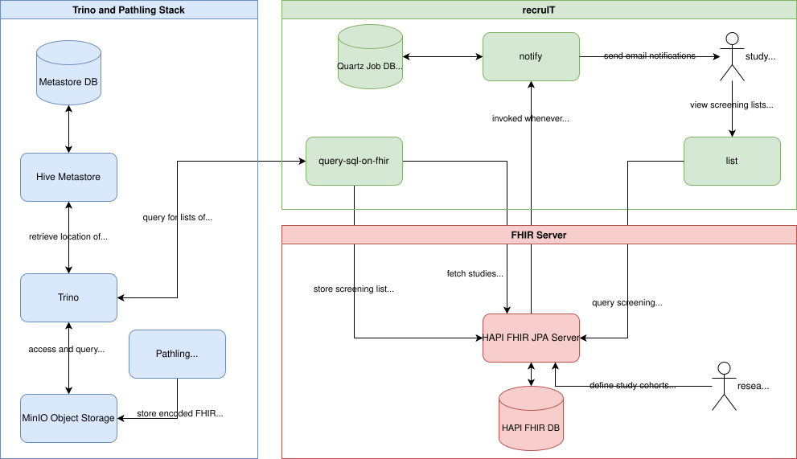
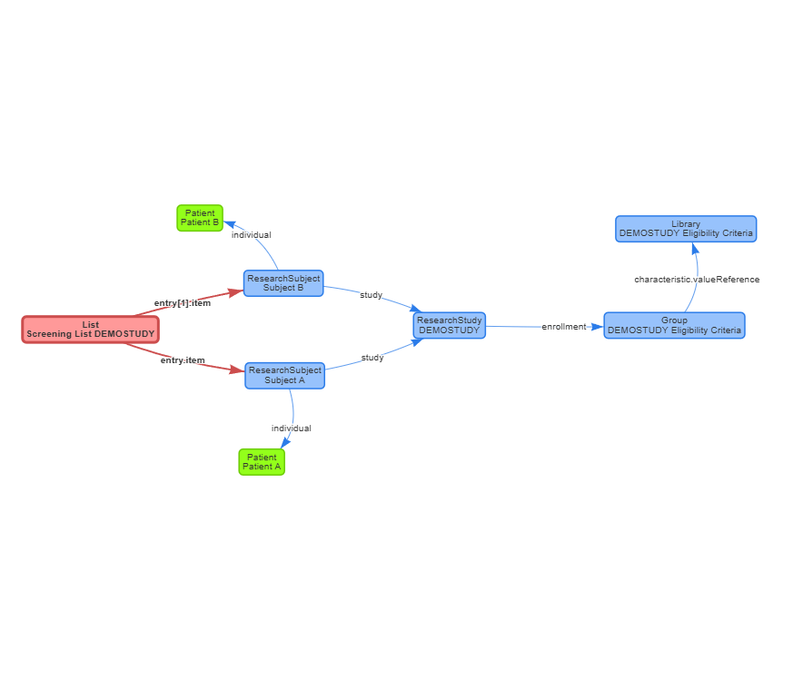

# Trino SQL-based Query Module

!!! warning

    This is an experimental feature that is still under development. Expect breaking changes at any time.

As of version `10.2.0`, it is possible to use recruIT without requiring the OHDSI OMOP stack.
Instead, cohorts can be defined using SQL that is directly executed against FHIR resources.
The prerequisite is that FHIR resources were previously encoded as Delta Lake tables using [Pathling](https://pathling.csiro.au/)
which can then be queried using [Trino](https://trino.io/). The same resources need to exist both as tables and inside a FHIR server
in order for the query module to correctly link them.

The advantage is that no semantic transformation from mapping FHIR resources to the OMOP CDM is necessary.

For trying it out without a lakehouse, the module can alternatively query FHIR resources stored as NDJSON files
directly using an embedded [DuckDB](https://duckdb.org/) when deployed via the Helm chart, see
[Querying FHIR resources with DuckDB](#querying-fhir-resources-with-duckdb).

To create the necessary tables, you can install a Pathling server and use the [`$import` operation](https://pathling.csiro.au/docs/server/operations/import)
to import FHIR bulk exports. You can find a demo setup for this approach at <https://github.com/bzkf/trino-on-fhir> as well.
If you're using Kafka, then <https://github.com/bzkf/fhir-to-lakehouse> is another way.

Because the return values of an SQL query can be arbitrary, the `query-sql-on-fhir` module assumes that one of the result columns is called `patient_id`
and contains the FHIR ID of the Patient ressource satisfying the eligibility criteria.

The `query-sql-on-fhir` module is part of both the compose-based setup and the Helm chart deployment but needs to be enabled using `--profile=trino`
for compose, and `query-sql-on-fhir.enabled=true` for the chart. Both assume that Trino and the required Delta Lake tables are already available.
The best way to try it out with sample data is following [the development setup](../development/contributing.md#setup-for-local-development).

The diagram below shows the changes compared to the default setup using OMOP:



Instead of using ATLAS, trial metadata is stored by creating FHIR ResearchStudy resources directly.
These studies then reference the elgibility critera as a FHIR Library which includes the SQL query that
encodes the study eligibility criteria.



## SQL Query Encoding

The eligibility criteria's SQL query is encoded using the
[SQLQuery](https://build.fhir.org/ig/FHIR/sql-on-fhir-v2/StructureDefinition-SQLQuery.html) profile
from the [SQL on FHIR v2](https://build.fhir.org/ig/FHIR/sql-on-fhir-v2/index.html) implementation
guide: a FHIR `Library` resource whose `content` carries the Base64-encoded SQL, and whose
`relatedArtifact` entries (if any) reference the `ViewDefinition` resources ("tables") that the
query depends on.

`query-sql-on-fhir` decides how to execute the query depending on the Library's content:

- If the Library has **no** `relatedArtifact` entries (i.e. it doesn't depend on any
  `ViewDefinition`) **and** it has a `content` entry with `contentType` set to
  `application/sql;dialect=<dialect>`, where `<dialect>` is the configured
  `query-sql-on-fhir.sql-dialect` (`QUERY_SQL_ON_FHIR_SQL_DIALECT`, `trino` by default), the SQL is
  executed directly against the configured database. A Library can carry the same criterion in
  several dialects side by side, one `content` entry each.
- Otherwise (the query depends on one or more `ViewDefinition`s, or no content in the configured
  dialect is present), the whole Library resource is sent as the `queryResource` input parameter to the
  [`$sqlquery-run`](https://build.fhir.org/ig/FHIR/sql-on-fhir-v2/OperationDefinition-SQLQueryRun.html)
  operation of a configured sql-on-fhir server. For the development setup, this is a
  [Pathling](https://pathling.csiro.au/) server, configured via the `sql-on-fhir.url` /
  `SQL_ON_FHIR_URL` property.

## Querying FHIR resources with DuckDB

Instead of Trino, `query-sql-on-fhir` can run the eligibility criteria against an embedded, in-memory
[DuckDB](https://duckdb.org/) that reads FHIR resources straight from NDJSON files, e.g. a
[FHIR bulk export](https://hl7.org/fhir/uv/bulkdata/). This needs no lakehouse, Hive metastore, or Trino, which
makes it a good fit for demos and small data sets - but since the files are re-read on every poll, it doesn't
scale to a production-sized patient population.

The Helm chart's [demo values](../getting-started/installation.md) use it: `syntheticPatients.enabled=true` loads
synthetic patients generated by [Synthea](https://github.com/synthetichealth/synthea) into the FHIR server, and an
init container of the query module's pod generates the exact same patients (same seed, same resource ids) once more
as NDJSON files into `/data/fhir/`. The views over them are created by `querySqlOnFhir.duckdb.initSql`, which is run
on every new connection, since each one is its own, empty in-memory database:

```yaml
querySqlOnFhir:
  sqlDialect: duckdb
  duckdb:
    initSql: |
      ATTACH ':memory:' AS fhir;
      CREATE SCHEMA fhir."default";
      CREATE VIEW fhir."default".patient AS SELECT * FROM read_json('/data/fhir/Patient.ndjson');
      CREATE VIEW fhir."default".condition AS SELECT * FROM read_json('/data/fhir/Condition.ndjson');
      USE fhir."default";
```

To query your own NDJSON files instead, mount them into the pod via `querySqlOnFhir.extraVolumes` and
`querySqlOnFhir.extraVolumeMounts`.

The views are named like the Delta Lake tables queried via Trino (`fhir.default.patient`, ...) and DuckDB infers
the same nested structure from the JSON resources, so a criterion's DuckDB SQL usually only differs where the
dialects do. The sample study's Libraries (see
[`sample-study.fsh`](https://github.com/open-recruit/recruit/blob/master/fhir/ig/input/fsh/sample-study.fsh))
carry each criterion in both dialects. Differences encountered so far:

| Trino                                                                       | DuckDB                                                                                                                  |
| --------------------------------------------------------------------------- | ----------------------------------------------------------------------------------------------------------------------- |
| `UNNEST(condition.code.coding) AS condition_coding`                         | `UNNEST(condition.code.coding) AS u(condition_coding)`                                                                  |
| `date_diff('year', date(patient.birthdate), current_date)` (complete years) | `date_sub('year', CAST(patient.birthdate AS DATE), current_date)` - DuckDB's `date_diff` counts year boundaries instead |

Since DuckDB infers each view's columns from the data, a criterion referencing an element that doesn't occur in any
of the files (e.g. `Condition.abatementDateTime`) fails, unlike with Pathling's fixed schema.

!!! note

    The DuckDB JDBC driver extracts its native library (~60 MiB) to `/tmp` when it's loaded, so `/tmp` must be large
    enough and allow executing files - the chart's `emptyDir` does both. Reading from S3-compatible object storage
    instead of local files works via
    DuckDB's [`httpfs` extension](https://duckdb.org/docs/stable/core_extensions/httpfs/overview), which is downloaded
    at runtime and so additionally requires internet access and a writable `extension_directory`.
